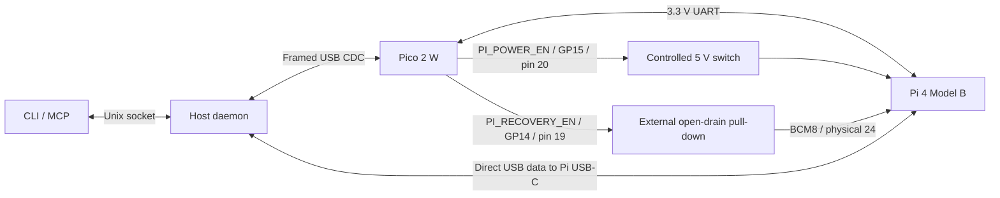

# Pi 4 Model B unattended recovery

Design verified against the linked official sources on 2026-10-09. Software
verification and physical fixture qualification are separate; no OTP or hardware
flash is performed while implementing this workspace.

Current host permission setup is `make setup-permissions`, using the tracked
[udev policy](../udev/README.md). It replaces the earlier port/user-specific
install scripts described in the historical commissioning record below.
Permission rules now match supported device types; the daemon still pins and
validates the commissioned fixture's USB topology, serial and SD LUN identity.

Current RAM payload setup is also reproducible: `make setup` prepares
`.local/polis-sbc-controller-tools/gadget/` from the pinned download and the package's
[recovery sources](../recovery/README.md). The daemon uses that path. References
to `.local/polis-recovery/` below describe historical commissioning artifacts;
that directory is no longer required by the tools.

## Current bench wiring and evidence — 2026-10-09

The Pi's current source is a **dedicated 5 V supply through the controlled
MOSFET switch**. Its fresh recovery boot and 30-second four-core load check
reported `throttled=0x0`; see the follow-up evidence below. The original source
was the **laptop's USB 5 V**, routed through the
existing MOSFET circuit into the Pi's USB-C adapter. Pico GP15 / physical pin 20
controls an N-channel MOSFET, which controls the P-channel MOSFET that switches
the Pi supply. GP15 supplies the control signal, not Pi operating power.

```text
Dedicated +5 V --> P-channel power switch --> Pi USB-C adapter VBUS
Pico GP15 -------> N-channel gate driver --> P-channel control
```

The user reported that daemon/Pico connection and physical Pi power cycling worked
with the original laptop-fed arrangement. The user has previously experienced unreliable Pi
operation when powered from a laptop; **this supply is provisional**. Successful
cycling does not establish adequate startup/load current, rail voltage at the
Pi, or stability during SD writes. Record voltage/undervoltage observations
during normal boot and recovery before relying on unattended reflashing. Do not
attribute boot/reflash failures solely to the image until power is checked.

The electrical rule is **no unswitched power path around the MOSFET**. Laptop
VBUS is allowed as the source upstream of the switch. If an external supply is
used later, isolate laptop VBUS rather than joining the two supplies. USB data
must reach the Pi USB-C D+/D- through the adapter, with common ground; that data
path was initially unverified; later commissioning evidence is recorded below.

A read-only daemon check after this report found the Pico connected, Pi power
commanded off, normal boot selection, and no captured UART bytes. It reported
two UART errors and no overruns/queue loss; these counters alone do not establish
Pi connectivity or identify a wiring fault. The user identified the current SD
image as an older `polis_*` build, whose normal boot was silent on UART.
Rebuilt base images now include UART logs/readiness and USB diagnostics; see the
[connectivity check](host.md#first-pi-uart-connectivity-check). No power, UART-write, or flash
command was issued during that check. OTP provisioning, USB recovery, SD
write/readback, and failed-boot recovery remain unverified.

A later captured hardware boot on 2026-10-09 includes kernel messages and
`POLIS_SMOKE_READY init uptime=3.18` through the Pico. This verifies the
Pi-to-Pico-to-daemon UART direction. Direct Pi USB enumerates as the diagnostic
device, but the first ping timed out: the startup script incorrectly requested
a hardware baud change from g_serial. That script is corrected in source;
the corrected image and host now pass the direct USB ping on hardware.
An additional startup race was reproduced: the first ping could precede the
responder opening its port. The host now retries that harmless ping within its
deadline. Immediately after a daemon-controlled power cycle, it received
`POLIS_USB_OK uptime=4.20`. This qualifies USB diagnostic data exchange, not
USB recovery, SD reflashing, or power stability under load.

## Recovery mechanism and prerequisites

### Commissioning progress — 2026-10-09

The user confirmed GP14 connects through an N-channel/open-drain transistor to
Pi GPIO8. The direct diagnostic USB device is on host topology `3-4`.
`.snapshots/polis_rpi4_musl_erofs-well-known/images/sdcard.img` is the previously
USB-tested snapshot 2, SHA-256
`847af678eb5e732c61322d64d2c7362489f7f4b58b1a4b886211b14dd5acece3`.
Inspection of its actual FAT boot partition confirms **no OTP provisioning
settings or recovery.bin**. None of this repository's normal build profiles
provisions GPIO-forced rpiboot. OTP is board state, not SD-image state; it has
not been read from this Pi.

Host preparation is complete, without changing physical-device state:

`make setup` now downloads the pinned `usbboot` checkout and its EEPROM submodule
and builds `rpiboot` under `.local/usbboot/`. That directory can be recreated after
deletion. See the repository [setup instructions](../../../README.md#build-tools-and-incremental-work)
for host prerequisites. Setup now recreates the same commissioned gadget bytes
under `.local/polis-sbc-controller-tools/gadget/`; provisioning records remain separate.

- Official `usbboot` commit `861a703d8b51f42b76bcdff49da3e0f2766966bf`
  is checked out under `.local/usbboot`; `make -C .local/usbboot` built `rpiboot`.
  Its `rpi-eeprom` submodule is pinned at
  `ded1e9332bd996f6adc46e10d22d9ef0298b1882`.
- The official `boot.img`, `config.txt`, and dereferenced `bootfiles.bin` are
  copied to `.local/polis-recovery/gadget`. Directory SHA-256 is
  `a41a8f03f22d78dd873903ea92056b302e6e879cf003f1f2ec8d4f6dd354dd2d`.
  The adapter validates the Pi 4 loader inside the official archive without
  extracting it; this payload passes software validation, not hardware acceptance.
- A **separate, unflashed** provisioning image is prepared at
  `.local/polis-recovery/provisioning/images-2711/pi4-program-rpiboot-gpio8.zip`
  using the pinned official `rpi-eeprom/imager/make-pi4-rpiboot-gpio-sd 8`.
  Booting it permanently selects GPIO8; do not include it in normal builds or
  use it as the daemon's RAM gadget or known-good image.

At host preparation, `RECOVERY_ENABLED` and `OTP_GPIO8_PROVISIONED` remained
false. Before enabling reflashing: complete OTP bring-up, observe the ROM and
RAM gadget on `3-4`, record the actual SD
LUN's `ID_PATH` and `ID_SERIAL_SHORT`, and qualify write/readback and normal
boot. The normal USB serial endpoint is not the recovery disk identity.
The source constants already pin the prepared host tool, RAM payload, and
observed USB port; the known-good candidate and hash are recorded alongside them.

The user subsequently explicitly authorized permanent GPIO8 OTP provisioning
on 2026-10-09 ("authorizing, send it"). The provisioning ZIP and extracted raw
image were verified; raw image SHA-256 is
`19c19501fc74f0c935153d5e34d9c944601e7e83562f3ae5c584f397e72d74f4`.
At that point the laptop exposed only its internal NVMe disk, with no SD card
available to write. Authorization is granted, but flashing and OTP programming
had not happened at that point.

Provisioning was then completed on the connected 15.9 GB card through the
Transcend reader, serial `000000000039`. The user ran the prepared writer with
sudo; the 270,532,608-byte image passed cache-invalidated SHA-256 readback.
After the user moved the card into the Pi, the daemon powered it on in Normal
mode. UART reported `Updating OTP to use GPIO8 to enable USB-device boot
(rpiboot)` and the user confirmed repeated green LED flashes.

**GPIO-forced ROM recovery is hardware verified.** A subsequent daemon-controlled
cold boot with recovery selected enumerated `0a5c:2711 BCM2711 Boot` on `3-4`.
`OTP_GPIO8_PROVISIONED` is now true. Evidence is in
`.local/polis-recovery/provisioning/otp-boot-uart.log`, `otp-result.json`, and
`.local/polis-sbc-controller-state/runs/1791588059369-14178703325a0fc9/`.
That run reached `rom_verified`, then stopped because libusb access was denied.
The user subsequently installed the ROM USB rule, resolving that permission failure.

The tested `recovery-usb --confirm-fixture bench-rpi4b` CLI command (MCP:
`recovery_usb`) runs commissioning through the daemon: validate the pinned RAM
payload, cold boot with the recovery strap, wait for the selected ROM, and load
the payload. It acquires the same operation lock, journals stages, and never
writes storage or OTP or retries an ambiguous operation. It deliberately does
not require a disk identity: discovering that identity is the next commissioning
step. `ram_payload_loaded` means the rpiboot transfer succeeded, not that a
storage LUN has been qualified. Status/log reads remain available throughout.

The user-started foreground daemon was replaced with the updated daemon under
the Codex session for commissioning. Its console log is
`.local/polis-sbc-controller-state/commissioning-daemon.log`. The prepared command
`sudo sh .local/polis-recovery/install-usb-rule.sh` installs a USB permission rule
limited to VID/PID `0a5c:2711` at port `3-4`, owned by the daemon user
`broosegoose`. This rule is installed and grants ROM USB access only.

**RAM recovery and the first complete reflash are hardware verified.** Run
`1791588192582-f9f90f1c9c7a703d` loaded the pinned official RAM payload. It
exported the 15,931,539,456-byte microSD as USB `0a5c:0104`, vendor `mmcblk0`,
serial `1000000000e4bb49`, with udev
`ID_PATH=pci-0000:00:14.0-usb-0:4:1.0-scsi-0:0:0:0` on USB port `3-4`.
These exact identities are now source constants. The desktop initially
automounted the provisioning partition; commissioning explicitly unmounted it.
The user installed `.local/polis-recovery/install-storage-rule.sh`, which grants
the daemon user access only to that SD LUN and sets `UDISKS_IGNORE=1` for the
Pi's exported storage. The runtime adapter still refuses mounted media and
never automatically unmounts it.

`RECOVERY_ENABLED=true` and the explicit `well-known` snapshot/hash are now
configured. Run `1791588482477-3e56fd5aece31f03` flashed that image via the RAM
gadget, verified all 327,156,224 bytes against its SHA-256 using direct readback,
returned the recovery strap to Normal, and reached a fresh UART readiness
marker. The unprivileged daemon owns the complete workflow; neither a root
daemon nor interactive sudo is needed for a run after installing device rules.
The run journal, verify JSON, and raw UART remain under
`.local/polis-sbc-controller-state/`.

**Automatic recovery from an unbootable image is hardware verified.** Run
`1791588593195-49dcd2e8611ed958` flashed a copy of `well-known` with only its
FAT `config.txt` changed to `kernel=polis_acceptance_missing.img` (a nonexistent
kernel). Candidate SHA-256 was
`3e416d46767a0d5a2798b5ed5c4a173eb8c2f78fa2947e005224b7d8b3f5068f`.
After the 60-second readiness deadline, the daemon autonomously cold-booted
GPIO-forced recovery, loaded the RAM gadget, flashed and verified `well-known`,
released recovery selection, and reached the fresh normal-boot marker. Final
status was `stage=recovered`, `recovery_attempts=1`, `active=false`.
Both full-image readback records match their respective expected hashes; the
initial boot failure and UART logs were retained. No manual power or flash
command intervened within this run. Known-good firmware is left running.

This qualifies the successful one-attempt recovery path on this fixture. Second
boot failure, ambiguous disconnect, and operation-lock exclusions have simulated
test coverage; destructive fault injection, rail timing measurements, a second
removable disk during selection, and sustained-load supply acceptance have not
been hardware-qualified. Native validation for this bring-up passed 19 daemon,
2 host API, 14 storage, and 4 CLI/MCP tests.

**Supply limitation observed:** the RAM kernel reported `Undervoltage detected!`
at 6.916 s and `Voltage normalised` at 8.932 s during commissioning. A subsequent
UART query returned `throttled=0x50000`. This is hardware evidence of a supply
problem, even if reflashing works. Laptop-fed power has not been qualified for
reliable boot timing or sustained load.

**Dedicated-supply follow-up — 2026-10-09:** the user replaced laptop 5 V with a
dedicated supply. The attempted fresh recovery boot
`1791589153776-fbaec2f4d2db44d0` timed out waiting for ROM enumeration; the normal
Linux USB endpoint remained at `3-4`. A separate daemon power-off command then
completed and refreshed Pico status reported `power_on=false`, yet the Pi still
answered `POLIS_USB_OK uptime=145.23` after three seconds. Thus the power-control
path is not currently removing Pi operating power. Supply routing, remaining
power feeds, and switch operation need checking; the precise cause is not yet
determined. No fresh `get_throttled` result was obtained and no image was flashed
during this follow-up. Logs are in `.local/polis-recovery/dedicated-supply-*`.
At that point the dedicated supply and recovery cold boots were not qualified.

The user then confirmed an accidental direct 5 V feed bypassing the switch and
corrected it. The off command now removes the Pi USB device. A fresh recovery
boot (`1791589336460-29136be7cd718b8a`) succeeded and reported
`throttled=0x0`, temperature 39.4°C. Four `/bin/yes` workers ran for 30 seconds
and were stopped/reaped; both subsequent `get_throttled` readings remained
`0x0`, at a measured post-load temperature of 49.1°C. Fresh captured UART
contained no undervoltage warning. This passes the boot/short-load check on the
corrected supply; it is not a long-duration or instrumented rail qualification.
No image was flashed during this check. Evidence replaces the dedicated-supply
JSON/UART files above; the JSON retains the initial failed check separately.
The [official flag definitions](https://www.raspberrypi.com/documentation/computers/os.html#get_throttled)
distinguish current undervoltage/throttling from their sticky history bits.

The Pi **4 Model B** can enter its ROM USB-device loader through a GPIO selected
in permanent OTP. It has no Compute Module nRPIBOOT jumper. Supported choices
are BCM 2, 4, 5, 6, 7, and 8. This fixture reserves **BCM8, physical pin 24**.
The selected pin must be low at cold boot to force rpiboot. Provisioning is
irreversible: the pin selection cannot subsequently be changed. The official
`make-pi4-rpiboot-gpio-sd` utility prepares a provisioning SD image; booting that
image programs OTP. **Provisioning requires separate authorization and physical
bring-up. Normal builds and recovery workflows never generate or boot a
provisioning image; the separately authorized bring-up above did so once.**
[Official Pi 4B instructions](https://github.com/raspberrypi/usbboot#enabling-rpiboot-support--extra-steps-for-pi-4b-pi-400--pi-500).

The loader transfers a separate kernel/initramfs into RAM. Its USB mass-storage
function exposes Pi storage to the host; it does not depend on the SD card's
installed OS or that OS's USB configuration. Use the official Linux
`mass-storage-gadget` payload (named `mass-storage-gadget64` in some releases),
not `recovery`, `secure-boot-recovery`, or EEPROM/OTP provisioning payloads.
The supplied config uses `boot_ramdisk=1`. Secure-boot-provisioned boards require
an appropriately signed payload. Pin the tested payload release and confirm
that its exported LUN is the Pi's microSD, not another attached storage device.
[Official gadget description](https://github.com/raspberrypi/usbboot/blob/master/mass-storage-gadget64/README.md),
[RAM boot configuration](https://github.com/raspberrypi/usbboot/blob/master/mass-storage-gadget64/config.txt).

Normal boot must have an EEPROM boot configuration that boots the intended SD
image. Confirm GPIO8 has no conflicting SPI/HAT connection and that OTP, secure
boot policy, card, supply, and USB wiring are qualified before enabling automatic
recovery. Recovery from an unreadable OS does not imply recovery from failed
storage, EEPROM/hardware faults, or a dead Pico.

## Connections and electrical contract



`PI_RECOVERY_EN` (GP14 / Pico physical pin 19) drives the gate/input of an external open-drain
transistor/buffer. Assert GP14 high to pull Pi GPIO8 low. Gate pull-down and an
appropriate Pi-side pull-up to **Pi 3.3 V** provide normal boot when the Pico is
reset or absent. Never pull the Pi pin up to the independently powered Pico.
Choose components that tolerate either board being unpowered; verify the
power-off leakage. Do not connect a push-pull Pico output directly to the boot
strap. GP14 replaces the earlier GP17 recovery assignment; GP17 now drives
the daemon-activity LED. Software cold-reset defaults are GP15 low (Pi off),
GP14 low (normal boot), and UART TX disabled while Pi power is off.

The additional connection terminates at the **Pi's USB-C device port**, not its
USB-A host ports. Use a qualified power/data breakout or equivalent circuit:
host D+/D- and ground reach the Pi, while **all Pi supply current passes through
the controlled switch**. In the original bench setup, laptop VBUS was the switch's
input and switched VBUS powers the Pi USB-C adapter. With a separate external
5 V source, disconnect host VBUS from the Pi supply instead. Retain any USB-C
CC/data requirements of the chosen breakout. An additional ordinary USB power
path around the switch would invalidate recovery. Do not use a
USB data blocker (it removes the data needed here). Verify with a meter/scope
that Pi 5 V falls when GP15 switches off, with both USB cables connected.
This circuit is a fixture design requirement, not a claim that every passive
VBUS-cut cable enumerates correctly.
[Official Pi 4 power requirements](https://www.raspberrypi.com/documentation/computers/raspberry-pi.html#power-supply).

## Software ownership and state transitions

The control-link migration retains `SetRecovery`, `Boot { mode, off_ms }`, and
boot timing. Update the daemon and Pico together: the library reports protocol
mismatch for the previous envelope, without an application firmware-version gate.
See the [current wire contract](../README.md#protocol). Selection alone is permitted only
while off and outside an active cycle. Coordinated Boot disables UART TX, switches
off, selects the strap, waits at least the requested off interval, and powers on. Recovery stays selected until
an explicit normal Boot or selection while off. Ordinary CyclePower preserves
the selection. Conflicting selection/power changes are rejected during a cycle.
The existing session/request high-water marks prevent duplicate execution.
USB reset/disconnection or four seconds without an accepted daemon request
switches power off and cancels an accepted cycle/Boot. Reconnection leaves power
off until explicitly commanded on. Recovery selection survives this shutdown;
Pico reset returns to off/normal.

A single Tokio serial worker discovers the Pico by the `embedded-api` crate's USB
product name, uses shared codec validation, drains UART continuously, and reconnects
without replaying queued commands. The Kameo service owns client requests; a fixture
operation lock excludes all other writes throughout a workflow. Status and log
reads remain available. A Unix socket is private to the daemon user. Process
locks prevent multiple daemons claiming the same Pico or recovery USB port.

Workflow: preflight explicit image/hash and fixture → recovery Boot → wait for
the selected Pi ROM → rpiboot RAM payload → identify selected microSD LUN →
write and read-back SHA-256 verify → normal Boot → wait for a fresh UART readiness
marker/deadline. Failed readiness may invoke exactly one known-good recovery
image attempt, followed by one normal boot/readiness check. A second failed boot,
transport ambiguity, write/verify failure, or recovery-loader failure ends the
run. There is no automatic retry of an uncertain flash or power operation.

Constants in `daemon/src/settings.rs` explicitly bind fixture name, direct
USB topology, disk udev identity, trusted payload path, and recovery image/hash.
Pi recovery has no enumeration-order selection or first-disk fallback. The rpiboot
`-p` option targets a USB topology path; block-device ancestry must match that
same path after re-enumeration.
[Official rpiboot selection implementation](https://github.com/raspberrypi/usbboot/blob/master/main.c).

Destructive workflow calls require the selected fixture name as confirmation.
Automatic recovery additionally requires a configured known-good image and an
explicit per-run opt-in. Boot-only monitoring can also opt into this single
recovery attempt. The daemon never starts/resumes a workflow merely on startup.
Run journals and raw UART/event logs retain stages, errors, and prior failed
readiness attempts. Interrupted runs require a new explicit invocation.

The Python storage adapter reuses `src.artifacts.images` image discovery and destination
validation. It adds exact udev/topology selection, source hash pinning, exclusive
block-device opening, source/destination rechecks, mounted/swap/holder rejection,
fsync and direct-I/O read-back verification that bypasses the host page cache. It never unmounts disks,
automatically elevates privileges, or expands partitions. The original interactive
`make flash` confirmation policy remains unchanged.

Readiness is an explicit UART substring emitted by the selected image, with a
configurable deadline. Recovery-kernel logs and old boot output cannot satisfy
normal-boot readiness: the capture cursor is established after a confirmed
power-off, before normal power-on. Rebuilt `polis_*` images emit
`POLIS_SMOKE_READY init`, matching the daemon default. Older snapshots keep
their original behavior. The normal image's USB serial diagnostic endpoint is
separate from the ROM/RAM recovery environment and does not expose the SD card.

## Separately authorized hardware acceptance

1. Provision and verify GPIO8 OTP on the intended Pi 4B; record board revision,
   security state, chip/USB identities, payload version/hash, and exported SD LUN.
2. Verify GP14 release/assert levels and Pi rail discharge with host USB attached;
   measure recovery strap setup and cold-boot timing before enabling automation.
3. Boot the RAM gadget from a deliberately unbootable SD image; verify only the
   commissioned fixture/LUN is selected with another removable disk attached.
4. Authorize a disposable-card write/read-back test, then normal boot and fresh
   readiness detection; repeat with malformed images, missing media, disconnects,
   and a stalled USB host. Failures must preserve logs and stop without replay.
5. Enable one automatic recovery attempt with a pinned known-good image; test
   both success and a second boot failure, daemon restart mid-write, concurrent
   clients, and Pico reset. Confirm human-intervention cases remain explicit.

### USB port mapping update — 2026-10-09

During benchmark commissioning the Pi was found on host USB port `3-2`, while
the Pico occupied the former `3-4`. The pinned-port check stopped the first
attempt before any flash. ROM serial `00e4bb49` and the same SD LUN serial
`1000000000e4bb49` were verified on the new port; source constants and udev rules
were updated. RAM loading, full image write/readback verification, and normal
boot subsequently passed. The current SD ID_PATH is
`pci-0000:00:14.0-usb-0:2:1.0-scsi-0:0:0:0`.
See [the five-boot benchmark record](benchmark.md#bench-qualification--2026-10-09).
